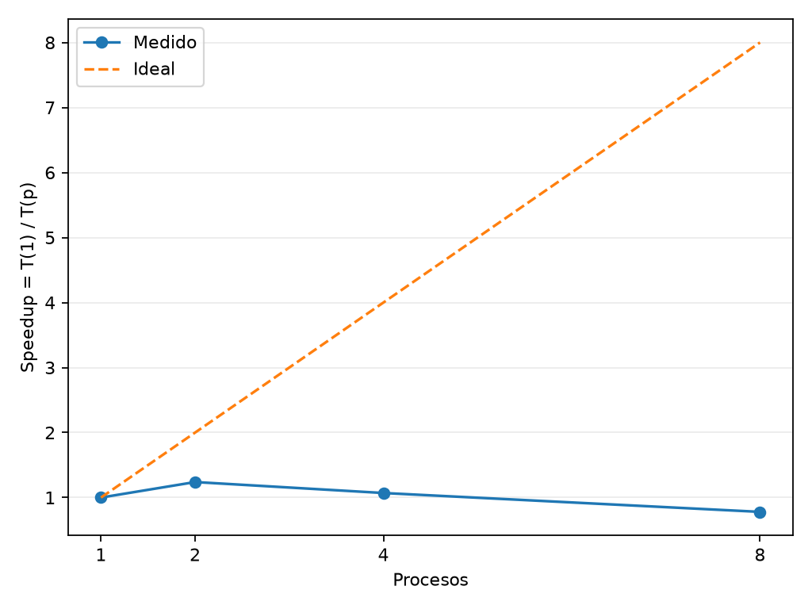
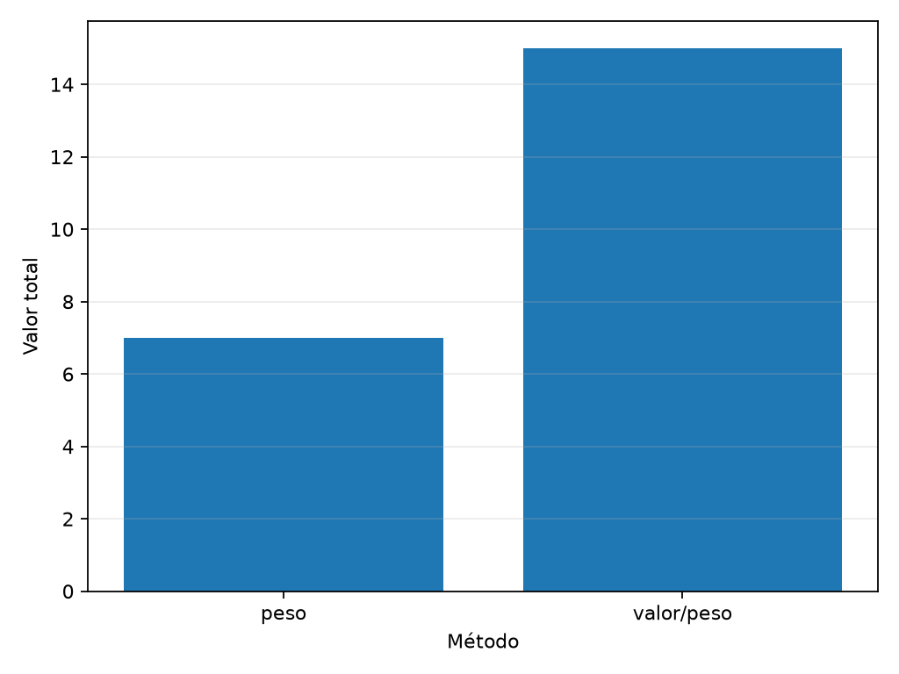
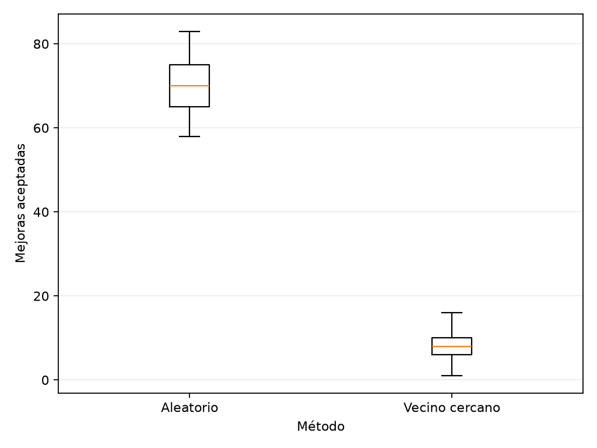
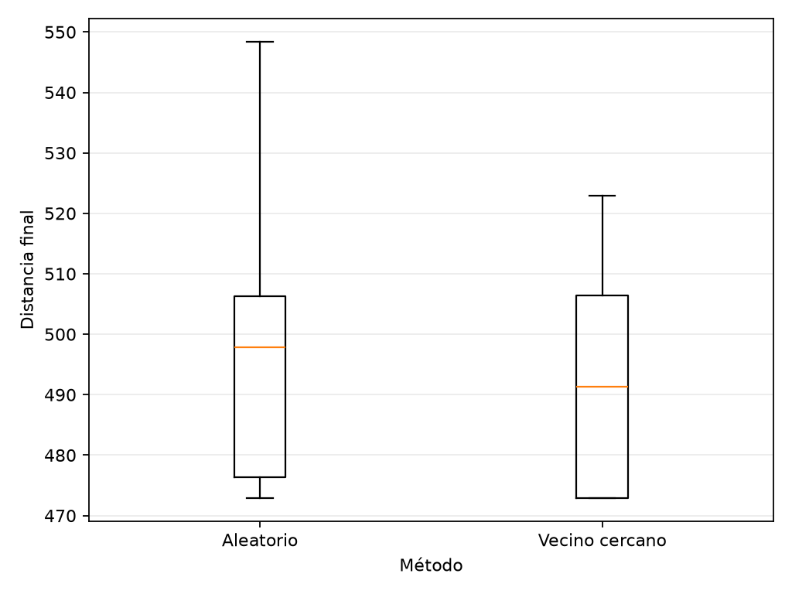
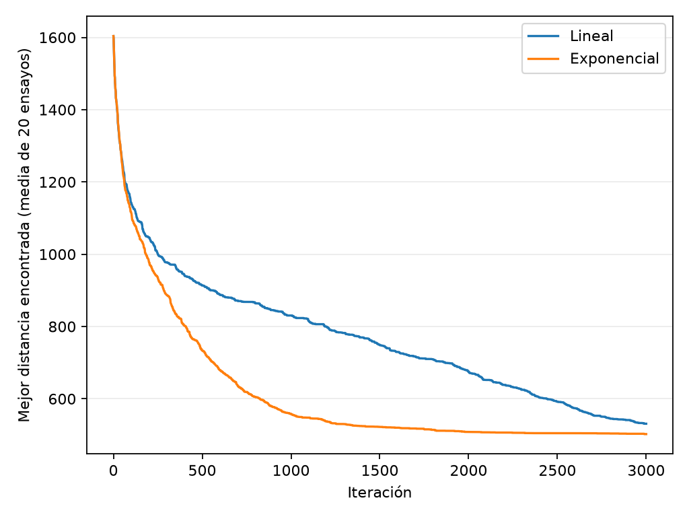
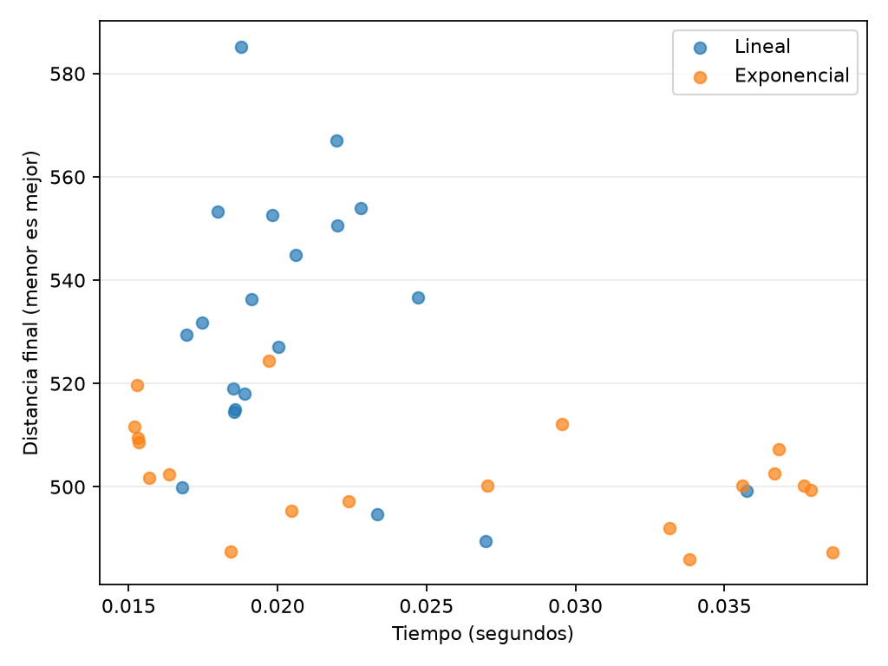
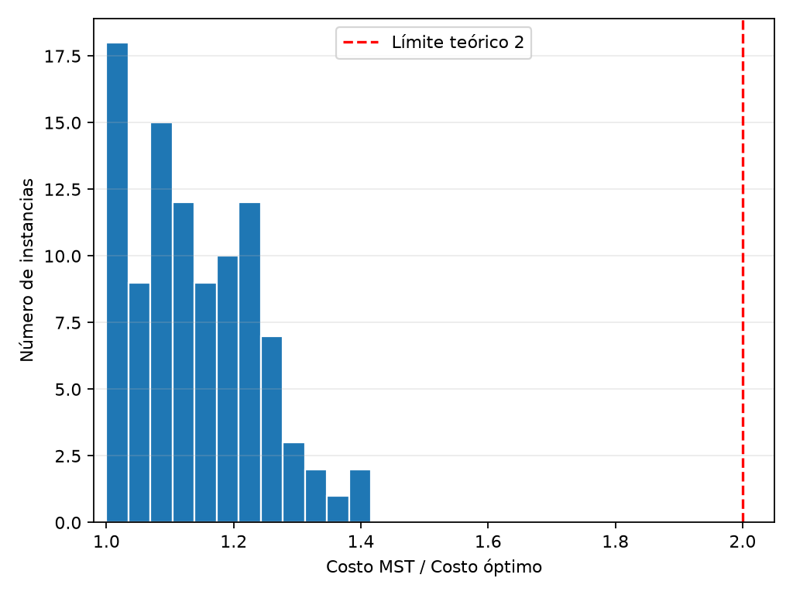
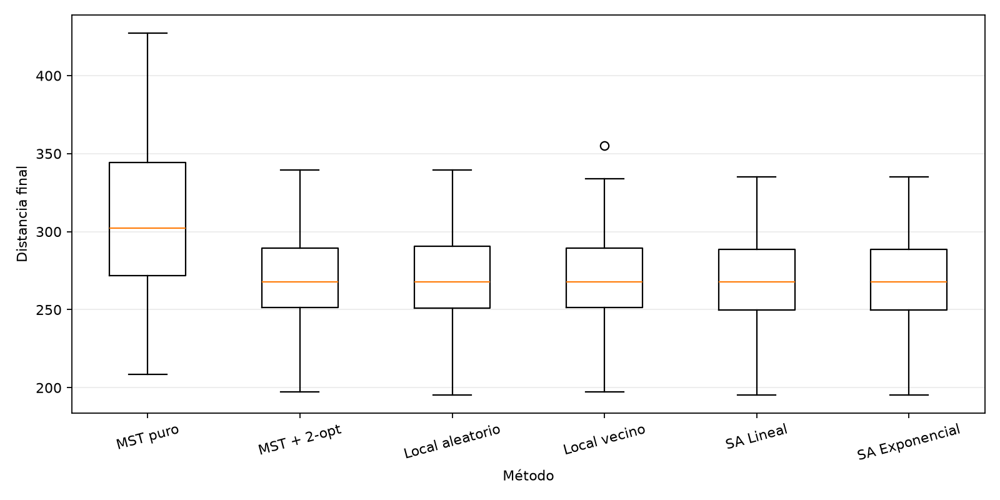

# Cinco experimentos con algoritmos

**Osvaldo González Martínez — Matrícula 2043042**

Repositorio público: **PENDIENTE: pegar URL del repositorio**

Video de demostración: **PENDIENTE: pegar enlace accesible del video**

## Objetivo y procedimiento

El objetivo fue observar cómo cambia el resultado al modificar la forma de trabajar de un
algoritmo. Se utilizó Python y Matplotlib. Se guardaron las mediciones en CSV para respaldar
las gráficas. La semilla base fue 2043042. Los resultados siguientes provienen de la ejecución
del entorno de preparación, no de la computadora personal del alumno.

Para TSP se generaron coordenadas uniformes en un cuadrado de 100 por 100 y se usó distancia
euclidiana. Menor distancia significa mejor solución. Todos los recorridos regresan al inicio.
Los experimentos 3 y 4 usan la misma instancia de 30 ciudades; el 5 utiliza otras 100
instancias, con nueve ciudades cada una.

## 1. Aceleración paralela

Se estimó pi con dos millones de puntos por ejecución y con 1, 2, 4 y 8 procesos. Cada
configuración se repitió tres veces; se tomó la mediana del tiempo. Se cambió el orden de
las configuraciones en cada repetición. Los mismos 32 bloques y semillas se repartieron entre
los procesos: cambiar la cantidad de procesos no cambia las muestras. Se incluye el tiempo
de creación, comunicación y cierre del grupo.

La aceleración es **S(p) = T(1)/T(p)**. El ideal sería S(p)=p.

| Procesos | Speedup medido | Ideal |
|---|---:|---:|
| 1 | 1.000 | 1 |
| 2 | 1.239 | 2 |
| 4 | 1.070 | 4 |
| 8 | 0.780 | 8 |

**Análisis.** La mayor aceleración observada fue aproximadamente 1.24 con dos procesos. Con cuatro bajó a 1.07 y con ocho fue de 0.78, lo que significa que usar ocho procesos tardó más que usar uno. Crear procesos, repartir tareas y juntar resultados consume tiempo.
También existe competencia por recursos del equipo. La ley de Amdahl explica que la parte
que no se paraleliza limita la aceleración: S(p) ≤ 1 / (s + (1-s)/p), donde s es la fracción
secuencial en un modelo ideal sin sobrecostos. Aquí los sobrecostos reducen todavía más
el resultado. No se midió cada sobrecosto por separado; no podemos atribuir la diferencia
a una sola causa ni concluir que cuatro procesos siempre sean lo mejor.

## 2. Mochila: menor peso frente a valor/peso

Se utilizó mochila 0/1 y capacidad cinco: no se permiten fracciones ni objetos repetidos.

| Objeto | Peso | Valor | Valor/peso |
|---|---:|---:|---:|
| A | 2 | 3 | 1.50 |
| B | 3 | 4 | 1.33 |
| C | 5 | 15 | 3.00 |

| Criterio | Objetos seleccionados | Capacidad usada | Valor total |
|---|---|---:|---:|
| Menor peso | A y B | 5 de 5 | 7 |
| Mayor valor/peso | C | 5 de 5 | 15 |

**Análisis.** Elegir los más ligeros llena la mochila con A y B, pero solo suma siete.
Elegir primero la mejor relación valor/peso toma C y suma quince. Ambos usan la misma
capacidad. Por eso, llenar la mochila no significa obtener mayor valor. Este ejemplo muestra
un caso donde menor peso pierde; el método valor/peso tampoco garantiza el óptimo para
todas las instancias de mochila 0/1.

## 3. Búsqueda local con 2-opt

2-opt invierte un segmento del recorrido; eso reconecta dos aristas. Se acepta la primera
inversión que reduce el costo y se reinicia la búsqueda. Se termina cuando ningún movimiento
2-opt mejora el recorrido. Cada inversión aceptada cuenta como una mejora, no como una
iteración examinada. Se hicieron 30 ensayos por tipo de inicio. Vecino Más Cercano empieza
en una ciudad aleatoria y elige la ciudad pendiente más próxima.

| Inicio | Mejoras medias | Distancia final media |
|---|---:|---:|
| Aleatorio | 70.17 | 495.71 |
| Vecino Más Cercano | 8.20 | 490.29 |

**Análisis.** En esta instancia, Vecino Más Cercano necesitó aproximadamente 88% menos
mejoras aceptadas. Una ruta inicial que ya conecta ciudades próximas suele tener menos
recorrido que corregir. Además, su distancia final media fue ligeramente menor. Las cajas
muestran la variabilidad entre ensayos; las medias de la tabla complementan esas gráficas.
Esto respalda la ventaja para estos datos, pero no demuestra que ocurra en toda instancia.
No se incluyó el trabajo de construir la ruta inicial en el número de mejoras. Menos mejoras
no equivale por sí solo a una medición de menor tiempo total. Un óptimo local puede seguir
siendo peor que el óptimo global.

## 4. Recocido simulado y enfriamiento

Se partió de rutas aleatorias y se propusieron inversiones 2-opt. Se aceptaron todas las
mejoras y algunos empeoramientos con probabilidad exp(-Δ/T), donde Δ es el aumento de
costo y T la temperatura. Se guardó siempre la mejor ruta encontrada.

Se compararon 20 ensayos por esquema, cada uno con 3000 movimientos. Ambos comienzan en
T₀=30 y terminan en Tf=0.01. Para u=k/(3000-1), se utilizaron:

- Lineal: T = T₀ + (Tf-T₀)u.
- Exponencial: T = T₀(Tf/T₀)^u.

Por ensayo se comparte la misma ruta inicial y la semilla del generador; las decisiones
pueden consumir números aleatorios distintos al divergir las trayectorias.

| Esquema | Distancia media de la mejor ruta | Tiempo medio por ensayo |
|---|---:|---:|
| Lineal | 530.95 | 0.02098 s |
| Exponencial | 502.29 | 0.02605 s |

La curva representa el promedio del **mejor costo encontrado hasta cada iteración**; por
eso no sube, aunque el algoritmo sí puede aceptar movimientos que empeoran la ruta actual.

**Análisis.** El exponencial obtuvo menor costo medio en este experimento. Con estos
extremos, enfría mucho antes que el lineal y dedica más movimientos a temperaturas bajas.
El lineal mantiene temperaturas altas durante más tiempo, favoreciendo la exploración,
pero aquí su presupuesto no produjo mejores rutas. El esquema exponencial obtuvo mejores soluciones, pero su tiempo medio fue mayor: 0.02605 segundos frente a 0.02098 del lineal. Ambos evaluaron 3000 movimientos; esta diferencia observada no demuestra que el exponencial siempre sea más lento.. Con un criterio de parada por temperatura o sin mejora,
en lugar de presupuesto fijo, los tiempos podrían cambiar de otra manera.

## 5. Aproximación basada en MST

Se generaron 100 instancias de nueve ciudades. Se construyó un árbol de expansión mínima
con Prim y se recorrió en profundidad desde la ciudad cero. La primera visita a cada ciudad
define el tour y se añade el regreso al inicio. En este reporte, «MST puro» significa ese
tour aproximado, no la suma de pesos del árbol.

Para calcular el óptimo exacto se fijó la ciudad cero y se examinaron las 8! = 40320
permutaciones restantes. Se usó razón = costo obtenido / costo óptimo. Uno indica que se
alcanzó el óptimo. El límite dos corresponde al TSP métrico: el recorrido del árbol duplicado
cuesta dos veces el MST y los atajos no aumentan el costo por la desigualdad triangular.
El MST no supera el costo del tour óptimo; de ahí se obtiene la garantía de factor dos.

Para MST puro, la razón media fue **1.1398** y la máxima **1.4161**. Es decir, el costo
medio relativo estuvo cerca de 14% por encima del óptimo y el peor caso observado cerca de
42%. Todos quedaron por debajo de dos. Esto no mejora la garantía teórica general: solo
describe estas cien instancias euclidianas pequeñas.

Se ejecutaron todos los métodos sobre las mismas cien instancias para comparar costos.
La búsqueda local utilizó ambos tipos de inicio y recocido ambos enfriamientos, conservando
3000 movimientos por ensayo. Cada método tuvo una ejecución por instancia.

| Método | Distancia media | Razón media | Razón máxima |
|---|---:|---:|---:|
| MST puro | 307.22 | 1.1398 | 1.4161 |
| MST + 2-opt | 270.17 | 1.0039 | 1.0719 |
| Local aleatorio | 269.70 | 1.0022 | 1.0683 |
| Local vecino | 270.11 | 1.0037 | 1.0599 |
| Recocido lineal | 269.10 | 1.0000 | 1.0000 |
| Recocido exponencial | 269.10 | 1.0000 | 1.0000 |

**Análisis.** Aplicar 2-opt a MST bajó el costo medio de 307.22 a 270.17: una reducción
aproximada de 12.1%. La razón media quedó muy cerca de uno. El resultado fue similar al de
las búsquedas locales y ligeramente peor en promedio que el recocido, que encontró el óptimo
en los cien casos de este experimento, según comparación con el cálculo exacto y tolerancia
numérica. No significa que recocido garantice optimalidad. Nueve ciudades es un tamaño pequeño.
Los boxplots de costos también reflejan que hay instancias naturalmente más largas; el CSV
permite comparar cada método dentro de cada instancia y contiene sus razones normalizadas.

La mejora posterior no puede empeorar el tour porque 2-opt solo acepta reducciones. Por eso
conserva la cota de dos del tour inicial bajo las mismas condiciones métricas. En las treinta
ciudades del ejercicio 4, el recocido tuvo resultados más variables; no se deben comparar
sus costos absolutos con los de nueve ciudades.

## Conclusión

En estos experimentos, aumentar procesos ayudó poco porque también existe trabajo de
coordinación. En mochila, ordenar por peso produjo una decisión sencilla pero de menor
valor. Para TSP, comenzar con Vecino Más Cercano redujo mucho las mejoras necesarias.
Recocido permitió explorar otras rutas y su resultado dependió del enfriamiento y del
presupuesto. Finalmente, MST dio una ruta con garantía teórica y 2-opt redujo considerablemente
su distancia. Mi principal observación es que una solución inicial y una mejora posterior
pueden complementarse, aunque los resultados deben comprobarse con varios ensayos.

## Archivos de respaldo y límites

Las tablas completas están en `resultados/`. Las gráficas se regeneran ejecutando el script.
Los tiempos dependen del hardware y la carga del equipo. No se midió aceleración de todo el
proyecto, solo de estimate_pi. El experimento local usa una sola instancia con varios inicios;
no permite generalizar a todas las distribuciones de ciudades. Quedan pendientes la URL
pública del repositorio y el video real de ejecución antes de entregar.
